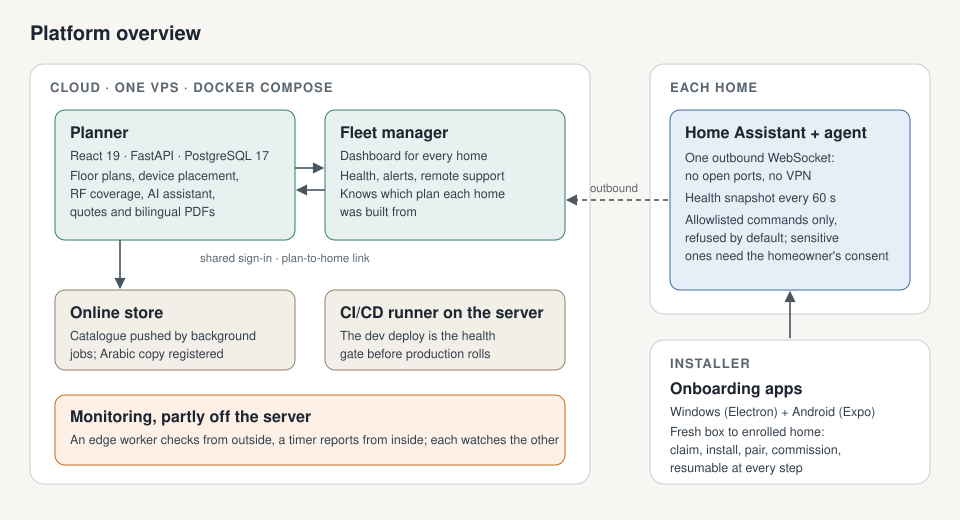
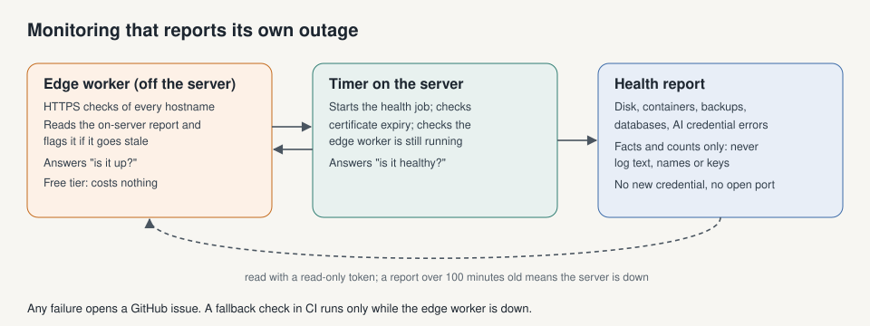

# Smart-home platform: planning, fleet management and installation

An engineering write-up of a smart-home platform I designed and built end to end, from the first floor plan to the box on the wall and the monitoring behind it.

It covers four connected products plus the infrastructure they run on. The source code is private, so this repo explains **how it works and why it's built that way**.

---

## 1. The planner: design a home's system before anything is bought

A multi-tenant web app where a home is drawn floor by floor, devices are placed on the plan, and the system shows whether it will actually work.

- **RF coverage that respects walls.** Wireless range is drawn on the floor plan and attenuated by every wall it crosses, using each wall's material, with openings handled separately. The same geometry exists twice, in TypeScript for live drawing and in Python for server-side checks, and **each side has its own test suite guarding the same math**.
- **Mesh validation.** Zigbee rules flag devices that won't have a reliable route.
- **AI planning assistant.** You can switch between providers behind one interface.
- **Quotes with options.** A project can carry several priced variants, and once a job moves past editing, everything afterwards (handoff PDF, client view, purchase orders) uses the *selected* one.
- **Bilingual PDFs.** The same code produces correct Arabic and English documents, with Arabic text shaping and right-to-left mirrored tables.
- **Smooth canvas.** Slow state (plan, devices, catalogue) lives in a store; fast state (drag, pan, the cursor ghost) never touches React state, which keeps dragging smooth.
- **Multi-tenancy and roles.** Owner, internal installer and external installer. External installers only see the jobs assigned to them and never see pricing, **enforced in the API, not just hidden in the UI**, with tests for tenant isolation and job scoping.

**Stack:** React 19 · Vite · TypeScript · Zustand · TanStack Query · SVG canvas · FastAPI · asyncpg · PostgreSQL 17 · Docker
**Size:** ~510 commits · 40 backend test files · 14 frontend test files

### Engineering decisions worth calling out
- **A SQL compatibility layer instead of a rewrite.** When the database moved from SQLite to PostgreSQL, ~110 query call sites stayed as they were. A small translator rewrites placeholders and date functions on the way to the driver. It's a character scanner, not a regex, so it never breaks a `?` inside a string or a comment, and it has its own tests.
- **Every test gets its own real database**, cloned from a template, so tests are isolated without rebuilding the schema each time.
- **Migrations are checksum-locked** once applied, and must be idempotent, so a new database and a migrated one end up identical. A test enforces this.
- **Background jobs are database rows.** Store sync jobs record live progress, survive restarts, run one at a time per store, and only ever *add* content, so they can never overwrite a person's edits.

## 2. The home agent: a secure link from each home to the cloud

A Home Assistant integration installed in every home.

- **One outbound encrypted WebSocket.** No port forwarding, no VPN, nothing exposed in the home.
- **Health snapshot every 60 seconds**: versions, integrations, add-ons, automations, critical logs, host metrics, low batteries and devices that have stopped reporting.
- **Remote commands are allowlisted, and refused by default.** The check runs inside the agent, on the actual service being called, in three tiers:
  - **Never**: shell access, scripts and shutdown are permanently blocked, whatever permission is granted.
  - **Sensitive**: locks, alarms, climate, reboots and account changes need the homeowner's consent, given on their own system. Support can ask for consent but can never grant it to itself. Installation access closes on its own after a set time.
  - **Routine**: reversible diagnostic calls.
- **A family-management screen in the home's own UI**, in English and Arabic.

**Size:** ~130 commits · CI validation on every push · released through HACS

## 3. Installer apps: from a fresh box to an enrolled home

A Windows app (Electron) and an Android app (Expo) for installers, on the bench and on site.

- **The steps live in platform-free TypeScript behind injected ports**, so both apps and a CLI share one core.
- **Resumable at every step.** Each step's state is saved, so a dropped connection, a dead battery, or Android killing the app means *resume*, not *start over*.
- **Boxes are identified by ID, never by name or address**, and each box is checked against a registry of approved hardware models.

**Size:** ~125 commits

## 4. Monitoring that reports its own outage

A monitor that runs on the server can't tell you the server is gone. So the system is split in two:
- **"Is it up?"** is answered from outside, by an edge worker on a free plan.
- **"Is it healthy?"** needs to look inside, so a timer on the server collects disk, containers, backups, databases and credential errors into a report. The report holds **facts and counts only**: no log text, no names, no keys. It reuses the CI runner already on the server, so it needs **no new credential and no open port**.
- **Each half watches the other.** If the report goes stale, the edge worker raises it; if the edge worker stops, the server raises it.
- **Every incident becomes a GitHub issue.**

It was built after an AI credential failure went unnoticed twice and was only found by hand. It now costs nothing to run.

## 5. Shipping

- **Two environments, one image.** A push to `dev` rolls dev only. A push to the production branch rolls **dev first as a health gate**, and production only after dev is healthy.
- **TLS proxy in front of containers that only listen locally.**
- **Built with a team of AI coding agents** under clear rules: I own the architecture, the decisions and the reviews; agents write code, tests and docs, and every deploy goes through the dev health gate.

---

*Diagrams drawn for this write-up. Product names, hostnames and customer data are left out on purpose.*
